# Implementacija koncepata interakcije s korisnikom u Flutter-u

Ovdje je tutorial pomoću kojega ćete teorijski i praktično naučiti načine interakcije aplikacije s korisnikom i korisnika sa aplikacijom. Aplikacija može na različite načine pokazati ili obavijestiti korisnika o nekoj aktivnosti ili akciji. Također korisnik može na različite načine upravljati tim obavijestima i točno to će se kroz ovaj tutorial pokazati. Za potrebe ovog tutorial-a napravljena je Flutter aplikacija koja implementira 6 koncepata interakcije s korisnikom: Toast, Snackbar, Floating Action Button(FAB) kontrole, korisničke dijaloge, jednostavne i složene notifikacije.

**Kolegij**: Razvoj aplikacija za mobilne i pametne uređaje

**Nositelj**: Izv. prof. dr. sc. Zlatko Stapić

**Suradnik**: univ. mag. inf. Dario Ljubas

## Sadržaj
1. [Uvod](#uvod)
2. [Kreiranje projekta](#kreiranje-projekta)
3. [Toast](#toast)
4. [SnackBar](#snackbar)
5. [FAB kontrole](#fab-kontrole)
6. [Korisnički dijalozi](#korisnički-dijalozi)
7. [Jednostavne notifikacije](#jednostavne-notifikacije)
8. [Složene notifikacije](#složene-notifikacije)


## Uvod
Interakcija između korisnika i aplikacije jedan je od najvažnijih koncepata danas i velika većina današnjih aplikacija ima neku od ovdje napravljenih vrsta interakcija. Aplikacija mora korisniku poslati odgovarajuću povratnu informaciju ovisno o tome koju akciju radi. Na primjer kada korisnik želi nešto obrisati moramo ga upozoriti da se taj element briše i dati mu opciju da potvrdi to brisanje zato što akcija brisanja se u većini aplikacija ne može vratiti jednom kada se nešto obriše ne može se vratiti tako je brisanje jedna od opasnijih akcija. Možda je korisnik slučajno pritisnuo brisanje i da mu se odmah ne obriše moramo mu dati opciju potvrde te radnje. To je samo jedna od komponenti koji će biti prikazani ovdje. U Flutter-u postoji više komponenti koje omogućuju različite oblike interakcija. Prikladnu komponentu biramo ovisno o situaciji, važnosti, korisničkoj situaciji i potrebom za korisničkom akcijom. Gore sam naveo koje komponente će se obraditi u ovom tutorial-u pa ću ih ovdje ukratko objasniti. 
- Toast - mala skočna obavijest koja se nakratko pojavljuje na zaslonu kako bi pružila jednostavnu povratnu informaciju o nekoj radnji
- SnackBar - mala, privremena obavijest koja se nakratko pojavljuje na dnu zaslona kako bi korisnicima pružila povratnu informaciju o procesu ili radnji koju su upravo izvršili
- Floating Action Button(FAB) - kružni ili zaobljeni gumb koji lebdi iznad glavnog sadržaja korisničkog sučelja, a služi za pokretanje jedne, najvažnije ili najčešće radnje na zaslonu
- Korisnički dijalozi - prozor koji se pojavljuje kako bi prikazao informacije, postavio pitanje ili zatražio unos od korisnika prije nego što mu omogući nastavak rada
- Jednostavne sistemske notifikacije - obavijesti koje Android prikazuje izvan samog korisničkog sučelja aplikacije
- Složene sistemske notifikacije - proširene obavijesti koje mogu sadržavati slike i akcijske gumbe

## Kreiranje projekta
Za praćenje ovog tutorial-a možete preuzeti moj GitHub repozitorij ili raditi sve što je ovdje navedeno. Za obje opcije trebali biste imati instalirani Flutter SDK, Visual Studio Code sa ekstenzijom Flutter te Android emulator ili Android mobilni uređaj. Ako ćete preuzimati moj repozitorij kada ga otvorite i stavite se unutar glavnog direktorija projekta u terminalu potrebno je izvršiti naredbu
`flutter pub get` 
Ova naredba preuzima sve pakete koji su korišteni u ovom projektu. 
Ako radite svoj projekt potrebno je u Visual Studio Code-u u gornjem search bar-u napraviti naredbu `>Flutter: Create New Project` kako biste kreirali svoj Flutter projekt. Kada to napravite odaberite u koju datoteku ćete spremiti svoj projekt odnosno u koju mapu će vas se kreirati projekt i onda bi ste trebali dobiti nešto ovako.

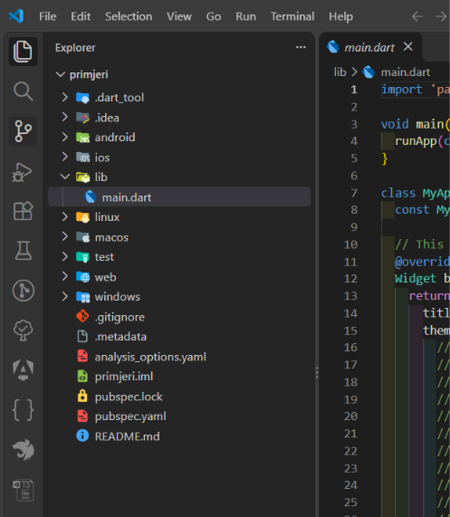

Nakon toga možete kreirati nove dart datoteke koje će nam pomoći za impementaciju svih komponenti za interakciju. Dodajte takvih 7 tako da u lib napravite desni klik i odaberete new file i nazovite ih kako hoćete, ali preporućujem da se zovu kao i sve te interakcije koje ćemo napraviti i dodate na kraju naziva .dart. Ovako sam ja to napravio pa preporučujem da i vi tako napravite kako biste lakše pratili. Povežite također i svoj android uređaj ili emulator kako biste mogli vidjeti što radite.

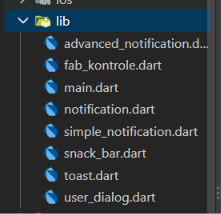

Sada možemo početi sa implementacijom svih interakcija.

Prvo u main-u sam napravio listu pomoću koje će se pokazivati svi primjeri odnosno pomoću koje ćete moći odabrati koji primjer želite.

```dart
import 'package:flutter/material.dart';
import 'package:fluttertoast/fluttertoast.dart';
import 'package:interakcija_s_korisnikom/notification.dart';

import 'toast.dart';

import 'snack_bar.dart';

import 'fab_kontrole.dart';

import 'user_dialog.dart';

import 'simple_notification.dart';

import 'advanced_notification.dart';

Future<void> main() async {
  WidgetsFlutterBinding.ensureInitialized();
  await notificationService.initialize();
  runApp(Aplikacija());
}

class Aplikacija extends StatelessWidget {
  const Aplikacija({super.key});

  @override
  Widget build(BuildContext context) {
    return MaterialApp(
      builder: FToastBuilder(),
      debugShowCheckedModeBanner: false,
      title: "Interakcija s korisnikom",
      home: HomeScreen(),
    );
  }
}

class HomeScreen extends StatelessWidget {
  const HomeScreen({super.key});

  @override
  Widget build(BuildContext context) {
    return Scaffold(
      appBar: AppBar(
        title: Text("Interakcija s korisnikom"),
        backgroundColor: Colors.red,
        foregroundColor: Colors.white,
      ),
      body: _buildListView(context),
    );
  }

  ListView _buildListView(BuildContext context) {
    return ListView(
      children: [
        ListTile(
          leading: Icon(Icons.chat_outlined),
          title: Text("Toast"),
          trailing: Icon(Icons.arrow_forward_ios),
          onTap: () {
            Navigator.push(
              context,
              MaterialPageRoute(builder: (context) => ToastScreen()),
            );
          },
        ),
        ListTile(
          leading: Icon(Icons.info_outline_rounded),
          title: Text("SnackBar"),
          trailing: Icon(Icons.arrow_forward_ios),
          onTap: () {
            Navigator.push(
              context,
              MaterialPageRoute(builder: (context) => SnackBarScreen()),
            );
          },
        ),
        ListTile(
          leading: Icon(Icons.add_circle_outline),
          title: Text("FAB kontrole"),
          trailing: Icon(Icons.arrow_forward_ios),
          onTap: () {
            Navigator.push(
              context,
              MaterialPageRoute(builder: (context) => FABControlScreen()),
            );
          },
        ),
        ListTile(
          leading: Icon(Icons.chat_bubble_outline),
          title: Text("Korisnički dijalozi"),
          trailing: Icon(Icons.arrow_forward_ios),
          onTap: () {
            Navigator.push(
              context,
              MaterialPageRoute(builder: (context) => UserDialogScreen()),
            );
          },
        ),
        ListTile(
          leading: Icon(Icons.notifications_none),
          title: Text("Jednostavne notifikacije"),
          trailing: Icon(Icons.arrow_forward_ios),
          onTap: () {
            Navigator.push(
              context,
              MaterialPageRoute(
                builder: (context) => SimpleNotificationScreen(),
              ),
            );
          },
        ),
        ListTile(
          leading: Icon(Icons.notifications_active_outlined),
          title: Text("Složene notifikacije"),
          trailing: Icon(Icons.arrow_forward_ios),
          onTap: () {
            Navigator.push(
              context,
              MaterialPageRoute(
                builder: (context) => AdvancedNotificationScreen(),
              ),
            );
          },
        ),
      ],
    );
  }
}

```

Za sada za main je jedino bitno reći da je to samo lista pomoću koje ćete moći odabrati što želite od interakcija odabrati. U flutteru se za navigaciju između različitih ekrana koristi Flutter-ova klasa Navigator.push() zato smo unutar stavke `ListTile` dodali svojstvo onTap koja obrađuje radnju kada korisnik klikne na odabranu stavku i u to svojstvo smo dodali taj `Navigator.push()` koji se poziva kada se klikne i šalje nas na ekran koji smo napisali a to definiramo pomoću `MaterialPageRoute`.

## Toast
U aplikaciji je izrađena klasa ToastScreen koja ima tri vrste toast poruka a to su kratki, dugi i custom toast. Svaki toast ima svoju funkciju u aplikaciji radi lakšeg snalaženja. Te funkcije su onda samo bile pozvane kod gumbova kako bi se izvršile. Za korištenje toast flutter nema svoj toast nego moramo dodati paket sa naredbom `flutter pub add fluttertoast` i nakon toga unutar odjelka dependencies se nalazi 
```dart
dependencies:
  flutter:
    sdk: flutter
  fluttertoast: ^10.0.2
```
Što nam sada omogućuje da napravitmo toast ali prvo na početku main i toast moramo dodati
```dart 
import 'package:fluttertoast/fluttertoast.dart';
```
Zatim možemo napraviti Toast
```dart
void kratkiToast() =>
    Fluttertoast.showToast(
      msg: "Toast🍞",
      toastLength: Toast.LENGTH_SHORT,
    );
```
Ovo je primjer kratkog Tost-a, dugi tost se radi na isti način samo promjenimo ovaj dio toastLength da piše `toastLength: Toast.LENGTH_LONG`
Sada ja sam napravio custom Toast zato što se Toast prije mogao prilagoditi međutim na Androidu 11 i novijim verzijama sustav ograničava prilagodbu standardnih Toast poruka. Zato za vlastiti izgled koristimo FToast, koji prikazuje prilagođeni Flutter widget. Kako bismo napravili custom toast u novim verzijama potrebno je u main-u unutar `MaterialApp` dodati `builder: FToastBuilder()` zatim unutar klase `_ToastScreenState` stvaramo objest `FToast()` i inicijaliziramo ga pomoću metode `initState(){}` Ovako sam ja napravio svoj custom toast
```dart
Widget buildToast() => Container(
  padding: EdgeInsets.symmetric(horizontal: 20, vertical: 12),
  decoration: BoxDecoration(
    borderRadius: BorderRadius.circular(25),
    color: Colors.green,
  ),
  child: Row(
    mainAxisSize: MainAxisSize.min,
    children: [
      Icon(Icons.check, color: Colors.black),
      SizedBox(width: 12),
      Text(
        "Ovo je naš custom toast",
        style: TextStyle(color: Colors.black, fontSize: 20),
      ),
    ],
  ),
);
```
Sve ovo sam prikazao pomoću gumbova kojima na onPress stavio da pozove određenu metodu. Ovako to izgleda

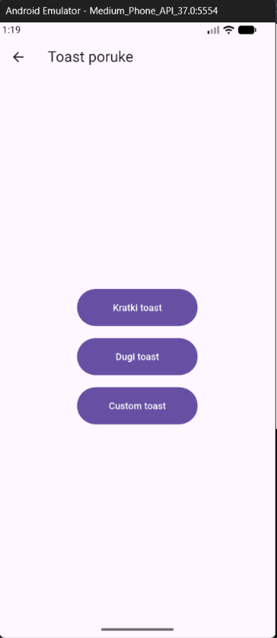

## SnackBar
Za razliku od Toast poruka, SnackBar može sadržavati akcijski gumb kojim korisnik može napraviti dodatnu radnju. SnackBar nije potrebno instalirati dodatan paket jer je već dio Flutterove Material biblioteke. U datoteci snack_bar napravio sam klasu SnackBarScreen, u kojoj sam implementirao tri primjera SnackBar poruka.Prvi primjer omogućuje korisniku unos bilješke pomoću TextField komponente. Za dohvaćanje unesenog teksta koristio sam TextEditingController. Ako korisnik ne unese ništa, prikazuje se poruka o pogrešci. Ako unese tekst, prikazuje se SnackBar s akcijskim gumbom „Prikaži”.
```dart
ScaffoldMessenger.of(context).showSnackBar(
  SnackBar(
    content: Text("Bilješka je uspješno spremljena"),
    action: SnackBarAction(
      label: "Prikaži",
      onPressed: () {
        if (!mounted) return;
        showDialog(
          context: context,
          builder: (context) => AlertDialog(
            title: const Text("Spremljena bilješka"),
            content: Text(tekst),
          ),
        );
      },
    ),
  ),
);
```
Za prikaz koristimo ScaffoldMessenger.of(context).showSnackBar(), dok SnackBarAction dodaje akcijski gumb. Kada korisnik klikne „Prikaži”, otvara se AlertDialog s tekstom bilješke. Drugi primjer samo ispiše neki tekst kojem sam stavio da traje 10 sekundi prije nego što se makne. Treći primjer pokazuje kako zamjeniti prethodnu snack poruku kada na primjer kliknemo 10 puta na drugi gumb svaki klik na gumb stavi u red čekanja poruku. Kako bismo to mogli na primjer spriječiti možemo napraviti takav gumb kakav sam ja napravio koji će zamjeniti te poruke i isprazniti taj red čekanje.
```dart
ScaffoldMessenger.of(context)
  ..clearSnackBars()
  ..showSnackBar(
    const SnackBar(
      content: Text("Prethodna poruka zamijenjena"),
    ),
  );
```
clearSnackBars() uklanja prethodne poruke iz reda čekanja i zatvara trenutačnu, nakon čega se prikazuje nova poruka. Ovdje koristimo Dartov operator .. kako bismo pozvali više metoda na istom objektu.

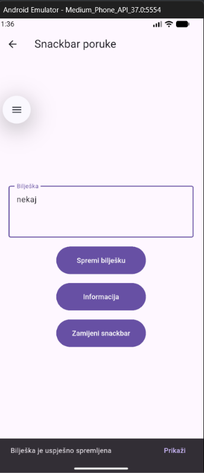

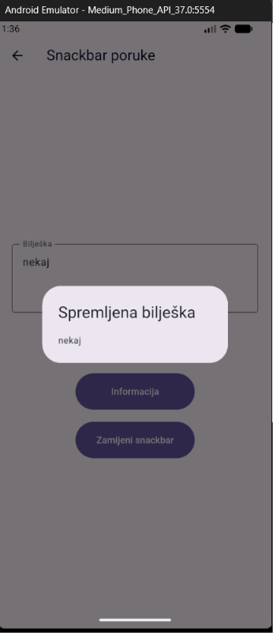

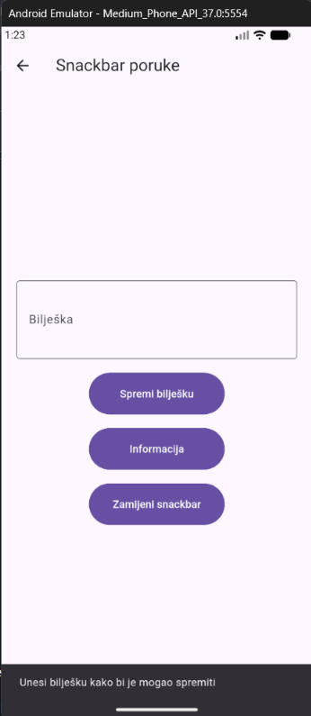

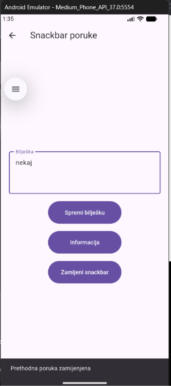

## FAB kontrole
FAB (Floating Action Button) istaknuti je gumb koji služi za izvršavanje glavne radnje na određenom ekranu. Prema Material preporukama, u pravilu se koristi jedan FAB po ekranu. Ima 3 vrsta FAB gumbova to su FAB, srednji FAB i veliki FAB prema m3 design. Postoji i mali FAB ali on se više ne preporučuje. Ja sam koristio samo obični FAB. U datoteci fab_kontrole napravio sam primjer dodavanja stavki u listu. Za spremanje stavki koristio sam listu issues, a pomoću metode dodajIssue() dodajem nove stavke.
```dart
List<String> issues = [];

void dodajIssue() {
  setState(() {
    issues.add("Issue ${issues.length + 1}");
  });
}
```
setState() obavještava Flutter da su se podaci promijenili i da treba ponovno izgraditi korisničko sučelje.

Zatim sam unutar Scaffold dodao FAB
```dart
floatingActionButton: FloatingActionButton(
  tooltip: "Dodaj zadatak",
  onPressed: dodajIssue,
  child: Icon(Icons.add),
),
```
Pritiskom na FAB poziva se metoda dodajIssue(), a nova stavka prikazuje se na ekranu. Za prikaz liste koristio sam ListView.builder. Svojstvo tooltip opisuje funkcionalnost gumba i pomaže kod pristupačnosti aplikacije. Znači kada se klikne na FAB jednom dobijemo Issue 1 a kada bi kliknuli više puta izledalo bi kao na slici znaci svaki klikom samo dodajemo novi issue.

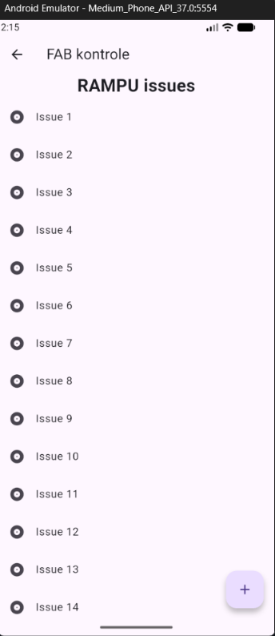

## Korisnički dijalozi
Dijalozi su prozori koji se prikazuju iznad trenutačnog ekrana. Koriste se kada aplikacija želi prikazati važnu informaciju ili zatražiti korisničku odluku.
U datoteci user_dialog napravio sam 4 primjera: informativni dijalog, dijalog za promjenu statusa zadatka, dijalog za potvrdu brisanja i dijalog za odabir prioriteta. Za prva tri primjera koristio sam AlertDialog, a za odabir prioriteta SimpleDialog.
Ovdje je primjer informativnog dijaloga koji sam napravio
```dart
void infoDialog() {
  showDialog(
    context: context,
    builder: (dialogContext) => AlertDialog(
      title: const Text("Informacije"),
      content: const Text(
        "Informativni dijalog koji pokazuje korisniku neke informacije",
      ),
      actions: [
        TextButton(
          onPressed: () {
            Navigator.pop(dialogContext);
          },
          child: const Text("U redu"),
        ),
      ],
    ),
  );
}
```

Pomoću metode showDialog() prikazuje se dijalog, a Navigator.pop() zatvara služi za zatvaranje dijaloga. Kod dijaloga za brisanje napravio sam mu 2 gumba koji su "Odustani" i "Obriši" i taj gumb obriši sam stavio u crvenu boju zato što je to akcija koja se više neće moći vartiti ali za potrebe primjera kada se obriše napravio sam da možemo vratiti to što smo obrisali kako bi se moglo prikazati sve što želim prikazati. Za odabir prioriteta koristio sam SimpleDialogOption, gdje korisnik može odabrati visoki, srednji ili niski prioritet. Odabrana vrijednost vraća se pomoću Navigator.pop(context, vrijednost) i prikazuje na ekranu. 

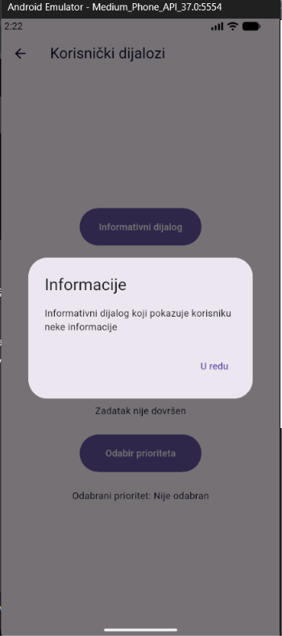

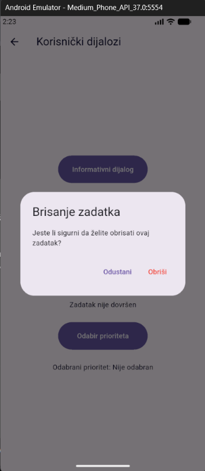

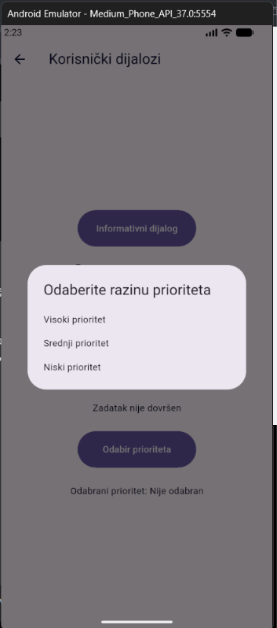

## Jednostavne notifikacije
Sistemske notifikacije su obavijesti koje Android može prikazati i kada korisnik nije unutar aplikacije. Jednostavna notifikacija sadrži ikonu, naslov i tekst poruke. Za njihovu implementaciju koristio sam paket flutter_local_notifications, koji se treba instalirati naredbom `flutter pub add flutter_local_notifications`
nakon toga sam importao to u dadoteku notification i prije implementacije notifikacija potrebno je prvo provjeriti dopuštenje za korištenje notifikacija zato što Android verzija 13 i novije verzije zahtjevaju korisnika da prihvati obavijesti kako bi mogao uopće dobiti obavijest zato sam prvo napravio tu provjeru.Prilikom instalacije paketa flutter_local_notifications potrebno je provjeriti i Android konfiguraciju projekta. Za verziju 23.0.0 paket zahtijeva Android compileSdk 37 ili noviji, odgovarajuću verziju Android Gradle Plugina te uključenu podršku za core library desugaring.

```dart
bool dopusteno = await android?.areNotificationsEnabled() ?? false;

if (!dopusteno) {
  dopusteno =
      await android?.requestNotificationsPermission() ?? false;
}

if (!dopusteno) return false;
```

Metoda areNotificationsEnabled() provjerava jesu li notifikacije dopuštene, dok requestNotificationsPermission() po potrebi traži dopuštenje. Za samo slanje notifikacija koristi se sljedeći kod.

```dart
await _notificationsPlugin.show(
  id: id,
  title: title,
  body: body,
  notificationDetails: notificationDetails,
);
```

id je identifikator notifikacije, title njezin naslov, body tekst poruke, a notificationDetails sadrži postavke prikaza. U datoteci simple_notification napravio sam gumb koji poziva notificationService.showNotification() i šalje korisniku primjer podsjetnika o predaji projekta.

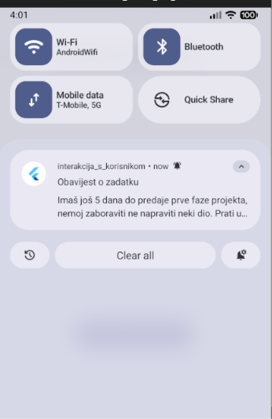

## Složene notifikacije
Složene notifikacije su iste kao i jednostavne samo daju mogućnost sadržavanja slika i gumbova. Ovdje se opet koristi `flutter_local_notifications` paket za notifikacije. Unutar klase NotificationService dodao sam metodu showAdvancedNotifiction(), koja prikazuje složenu notifikaciju, a za prikaz slike koristio sam BigPictureStyleInformation 
```dart
styleInformation: BigPictureStyleInformation(
  DrawableResourceAndroidBitmap("catworker"),
  contentTitle: "",
),
```
BigPictureStyleInformation omogućuje prikaz velike slike kada korisnik proširi notifikaciju. DrawableResourceAndroidBitmap dohvaća sliku iz Androidovih resursa.
Sliku catworker.jpg dodao sam u direktorij: android/app/src/main/res/drawable/
Također sam dodao dva akcijska gumba pomoću AndroidNotificationAction
```dart
actions: <AndroidNotificationAction>[
  AndroidNotificationAction(
    "ukloni",
    "Ukloni",
    showsUserInterface: false,
    cancelNotification: true,
  ),
  AndroidNotificationAction(
    "otvori",
    "Otvori aplikaciju",
    showsUserInterface: true,
    cancelNotification: true,
  ),
],
```

Pomoću prvog gumba samo mičemo notifikaciju dok drugi gumb nam otvara aplikaciju. `cancelNotification` određuje hoće li se notifikacija ukloniti nakon korisničke akcije, a `showsUserInterface` određuje treba li prikazati korisničko sučelje aplikacije. Kako bih mogao koristiti akcijske gumbime u AndroidManifest.xml, unutar elementa `<application>`, dodao sam receiver
```xml
<receiver
    android:name="com.dexterous.flutterlocalnotifications.ActionBroadcastReceiver"
    android:exported="false" />
```

Na kraju sam u datoteci advanced_notification.dart napravio ekran s gumbom koji poziva metodu showAdvancedNotifiction().

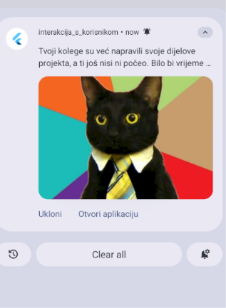


## Literatura

1. Flutter experts - "Custom Toast Message in Flutter" - https://flutterexperts.com/custom-toast-message-in-flutter/
2. Pub.dev - "fluttertoast" - https://pub.dev/packages/fluttertoast
3. GeeksForGeek - "Fluttertoast in Flutter" - https://www.geeksforgeeks.org/flutter/fluttertoast-in-flutter/
4. Androidride - "4 Flutter ListView Navigation Examples With Tutorial" - https://androidride.com/flutter-listview-navigation/
5. Flutter docs - "Display a snackbar" - https://docs.flutter.dev/cookbook/design/snackbars
6. Flutter docs - "Retrieve the value of a text field" - https://docs.flutter.dev/cookbook/forms/retrieve-input
7. Flutter - "FloatingActionButton class" - https://api.flutter.dev/flutter/material/FloatingActionButton-class.html
8. M3 material - "FloatingActionButton" - https://m3.material.io/components/floating-action-button/overview
9. Flutter - "Dialog class" - https://api.flutter.dev/flutter/material/Dialog-class.html
10. Flutter - "AlertDialog class" - https://api.flutter.dev/flutter/material/AlertDialog-class.html
11. Flutter - "Simple Dialog class" - https://api.flutter.dev/flutter/material/SimpleDialog-class.html
12. WTF code - "Local notification in flutter" - https://codewtf.com/local-notifications-in-flutter/
13. pub.dev - "Flutter local notifiactions" - https://pub.dev/packages/flutter_local_notifications#notification-payload
14. Android Developers - "receiver" - https://developer.android.com/guide/topics/manifest/receiver-element
15. Medium - "Notifications in Flutter" - https://medium.com/@codernta/notifications-in-flutter-a-practical-guide-to-different-types-and-how-to-implement-them-easily-f66bdcd3b6b5
16. Material Design 3 – Snackbar. https://m3.material.io/components/snackbar/guidelines
17. Material Design 3 – Floating action button. https://m3.material.io/components/floating-action-button/guideline
18. Material Design 3 – Dialogs. https://m3.material.io/components/dialogs/guidelines
19. Flutter - "Navigate to a new screen and back" - https://docs.flutter.dev/cookbook/navigation/navigation-basics
20. Flutter - "ShowSnackBar method" - https://api.flutter.dev/flutter/material/ScaffoldMessengerState/showSnackBar.html
21. Dart - "Asynchronous programming" - https://api.flutter.dev/flutter/material/ScaffoldMessengerState/showSnackBar.html
